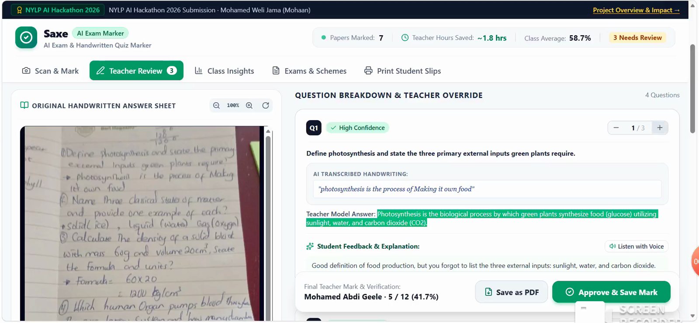
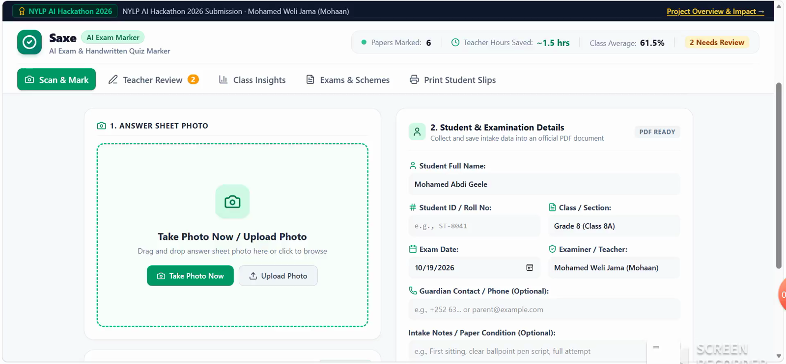
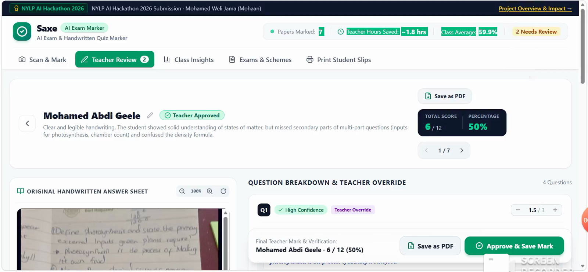
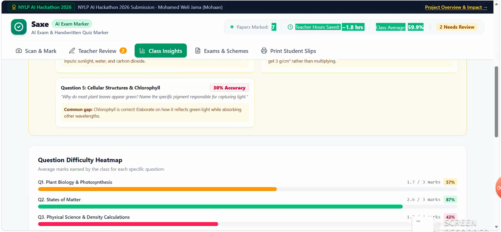

# Saxe – AI Exam Marker

**NYLP AI Hackathon 2026 · Build AI for Real-World Impact · Category: Education**

Saxe ("correct" in Somali) is an AI exam marker for teachers. A teacher photographs a student's handwritten answer sheet, and Saxe reads the handwriting, marks every answer against the teacher's own marking scheme, and writes a short explanation for every lost mark. The teacher reviews and approves every result.

| | |
|---|---|
| **Live demo** | https://ai-marking-exam.onrender.com |
| **Demo video** | [add your YouTube / Drive link] |
| **Built by** | Mohamed Weli Jama (Mohaan) |

> Hosted on Render's free tier, so the first load can take up to a minute while the server wakes up.



---

## Problem

In Somaliland, teachers mark every exam and quiz by hand.

- **Teachers are overloaded.** Many teach several classes and give private tuition, so marking takes their evenings.
- **Feedback is thin.** Under time pressure, students get a tick, a cross and a score. They learn *that* they were wrong, not *why*.
- **No class-level insight.** Teachers rarely have time to see which questions most of the class got wrong.
- **Existing tools don't fit.** Most auto-grading tools need typed answers on online exams. Our students write on paper.

I teach in Somaliland myself, so this project comes from a problem I face every week.

## Solution

1. The teacher creates a marking scheme (questions, model answers, marks, partial-credit rules), or generates one with AI from a topic.
2. The teacher takes a photo of a student's handwritten answer sheet, or uploads one.
3. Gemini reads the handwriting, marks each answer against the scheme, gives partial credit, and writes feedback.
4. The teacher reviews every mark and can change any of them before approving.
5. Class Insights shows results across the class, so the teacher knows what to re-teach.

## Features

- **Photo-to-marks:** handwriting transcription and marking in one step.
- **Partial credit:** correct working is rewarded even when the final answer is wrong.
- **Feedback for every lost mark:** short, student-friendly explanations.
- **Confidence flags:** each answer is rated high / medium / low confidence; illegible handwriting is flagged for the teacher, never guessed.
- **Teacher review and override:** AI suggests, the teacher decides.
- **AI marking-scheme generator:** create a scheme from a topic or notes.
- **Class Insights:** roster with scores, pass / needs-support filters.
- **Audio feedback:** feedback can be read aloud to students (Gemini TTS, with browser speech as fallback).
- **PDF reports and printable student slips.**

## Tech stack

| Layer | Technology |
|---|---|
| Frontend | React 19, TypeScript, Vite, Tailwind CSS, Motion, Lucide icons |
| Backend | Node.js + Express (`server.ts`), run with `tsx` |
| AI | Google Gemini API via `@google/genai` |
| PDF | jsPDF |
| Storage | Browser `localStorage` (no server database) |
| Hosting | Render (Web Service) |
| Built with | Google AI Studio (AI-assisted development) |

## AI methodology

AI is the core of the product: a multimodal model reads handwriting and reasons about each answer against the scheme, which a rules-based system cannot do.

**Models** (`server.ts`)

| Use | Model |
|---|---|
| Marking + scheme generation | `gemini-3.5-flash`, with `gemini-3.8-flash` as automatic fallback |
| Audio feedback | `gemini-3.8-flash-lite-tts` |

**Marking pipeline** (`POST /api/mark-sheet`)

1. The browser downscales the photo and sends it, with the marking scheme, to the Express backend.
2. The backend builds a prompt containing every question, the model answer, acceptable variations and partial-credit rules.
3. Gemini receives the image plus the prompt, with **temperature 0.1** for consistent marking.
4. The response is forced into **structured JSON** using a response schema: per question it returns the transcribed answer, marks awarded, confidence, flag reason and feedback.
5. The backend **checks and cleans the result in code**: marks are clamped between 0 and each question's maximum, and **totals and percentages are calculated by the program, not the model**, so the maths is always correct.
6. Any low-confidence answer marks the paper as "flagged" for teacher review.

**Prompt design.** The system prompt makes the model a fair, careful marker and sets firm rules: transcribe faithfully, **never guess illegible handwriting** (write "[Illegible / Unreadable]" and set confidence to low), give partial credit for correct working, and explain every lost mark in encouraging language.

**Other AI endpoints**

- `POST /api/generate-scheme`: generates a structured marking scheme (JSON schema) from a topic, subject and grade.
- `POST /api/speak-feedback`: turns feedback text into speech.

## Responsible AI, privacy and security

- **Human in the loop:** every AI mark can be changed by the teacher before it is approved.
- **No guessing:** unclear handwriting is flagged instead of invented.
- **Correct totals:** arithmetic is done in code, not by the AI.
- **API key stays on the server:** the Gemini key is read from an environment variable on the backend and is never sent to the browser or committed to the repo.
- **Minimal data:** results are stored only in the teacher's own browser; no student data is kept on a server.

## Known limitations

- Very messy handwriting or blurry photos lower accuracy (these are flagged for review).
- Long essay answers are harder to mark fairly than short answers and maths.
- Feedback is currently in English only; Somali feedback is planned.
- Needs internet to reach the Gemini API.
- The API has no login or rate limiting yet, so it is a demo, not a production deployment.
- The demo includes some pre-filled sample results to show Class Insights; new papers are marked live by Gemini.

## Setup

**Requirements:** Node.js 20+ and a free Gemini API key from [Google AI Studio](https://aistudio.google.com/).

```bash
git clone https://github.com/Mohamed-45-kd/AI-Marking-Exam.git
cd AI-Marking-Exam
npm install
cp .env.example .env        # then put your key in .env as GEMINI_API_KEY
npm run dev                 # http://localhost:3000
```

Never commit your real `.env` file. It is already in `.gitignore`.

**Production / Render**

- Build command: `npm install && npm run build`
- Start command: `npm start`
- Environment variables: `NODE_ENV=production`, `GEMINI_API_KEY=<your key>`

The app needs a running Node server (the AI calls are made server-side), so it is hosted on Render rather than a static host.

## Screenshots

| Upload an answer sheet | AI marking in progress |
|---|---|
|  |  |

| Teacher review and override | Approved student result |
|---|---|
|  |  |



## Future plans

- Feedback in Somali as well as English.
- Batch upload to mark a whole class at once.
- Teacher accounts and a cloud database.
- Pilot with teachers at schools in Somaliland and measure accuracy against teacher marks.

## Team

| Member | Role | Contribution |
|---|---|---|
| Mohamed Weli Jama (Mohaan) | Solo builder | Problem research, product design, full-stack development, AI prompt and pipeline design, testing with real answer sheets, deployment, demo |

## Acknowledgements and third-party tools

Google Gemini API, Google AI Studio, React, Vite, Tailwind CSS, Express, jsPDF, Lucide, Motion, Render. AI coding assistants were used during development; all code was reviewed and tested by the author.
